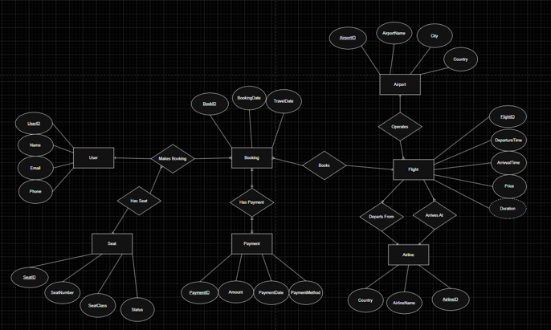
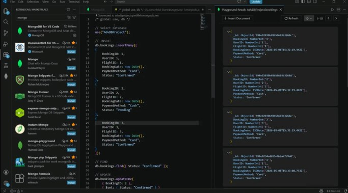

# Flight Booking Database System

A team project for the **Advanced Database** course that models a flight reservation workflow and demonstrates relational database implementation, transaction handling, query optimization, and analytical reporting.

The system is implemented primarily in **Microsoft SQL Server (T-SQL)**. It includes a relational schema for users, airlines, airports, flights, seats, bookings, and payments, plus a star-schema data warehouse for booking analysis. A MongoDB demonstration is also represented by the screenshot included in this repository.

## Project Overview

The project simulates core data operations in a flight booking system, from storing flight and customer information to recording bookings and payments. It also explores database concepts that support correctness and reporting, including transactions, rollback, stored procedures, window functions, indexing, ETL, and analytical queries.

## Features

- **Relational database design:** tables for `Users`, `Airline`, `Airport`, `Flight`, `Seat`, `Booking`, and `Payment`, with primary and foreign key relationships.
- **Sample data:** SQL inserts provide example users, airlines, airports, flights, seats, bookings, and payments for testing queries.
- **Transactions:** a sample booking transaction updates seat status and records a booking and payment.
- **Stored procedure:** `BookFlightFull` checks whether a seat exists and is available, retrieves the flight price, then performs the seat update, booking insert, and payment insert within a transaction. It uses `TRY...CATCH` and rollback handling.
- **Concurrency and recovery coursework:** the project work demonstrates blocking and dirty-read behavior across SQL Server sessions, along with rollback and simulated-error scenarios. The concurrency demonstrations are described in the accompanying coursework report; they are not provided as a separate standalone script in this repository.
- **Window functions:** `RANK()` ranks flight prices within each airline country.
- **Query optimization:** nonclustered indexes are created for `Flight(AirlineID, Price DESC)` and `Airline(Country)`.
- **Data warehouse and ETL:** dimension tables and a `Fact_Booking` table are populated from the operational tables.
- **Analytical queries:** queries calculate revenue per airline, booking counts per airline, popular destination airports, revenue by payment method, and average ticket price per airline.
- **MongoDB demonstration:** a screenshot records the NoSQL component. The MongoDB commands are not included as a separate script in the current repository.

## Technologies

- Microsoft SQL Server
- Transact-SQL (T-SQL)
- SQL Server Management Studio (SSMS) or another SQL Server-compatible client
- MongoDB (coursework demonstration)

## Repository Contents

| File | Description |
|---|---|
| [`Adv_DB_Proj (1).sql`](<Adv_DB_Proj (1).sql>) | Main T-SQL script: database and table creation, sample data, transactions, recovery examples, stored procedure, indexes, window function, warehouse tables, ETL, and analytical queries. |
| [`eerd-screenshot.png`](./eerd-screenshot.png) | Entity-relationship diagram screenshot. |
| [`mongodb-screenshot.jpg`](./mongodb-screenshot.jpg) | Screenshot of the MongoDB/NoSQL demonstration. |
| `README.md` | Project overview and instructions. |

## Database Model

The operational schema contains the following main entities:

- **Users** — user details.
- **Airline** — airline name and country.
- **Airport** — airport name, city, and country.
- **Flight** — airline, origin and destination airports, departure and arrival times, and price.
- **Seat** — seat number and availability status for a flight.
- **Booking** — user, flight, optional seat, and booking date.
- **Payment** — payment amount and payment method associated with a booking.

Foreign keys connect flights to airlines and airports, seats to flights, bookings to users and flights, and payments to bookings.

### Entity-Relationship Diagram



## Data Warehouse

The warehouse section uses a **star-schema-style design** with `Fact_Booking` and the following dimension tables:

- `Dim_User`
- `Dim_Airline`
- `Dim_Airport`
- `Dim_Flight`
- `Dim_Seat`
- `Dim_Payment`

The SQL script extracts data from the operational tables into the dimensions and then loads booking facts. The analytical queries use this model to summarize booking and revenue information.

## Getting Started

### Prerequisites

- A running Microsoft SQL Server instance.
- SSMS or another client that can execute T-SQL batches.
- Permission to create a database on the selected SQL Server instance.

### Run the SQL Script

1. Clone or download this repository.
2. Open `Adv_DB_Proj (1).sql` in SQL Server Management Studio.
3. Review the script and select your intended SQL Server instance.
4. Execute the script in a **test/development environment**. It creates a database named `Adv_DB_Project` and populates it with sample data before running the database exercises and analytical queries.
5. Review the query results and screenshots as the script runs.

> **Important:** The script is intended for a coursework demonstration, not as a production deployment or an idempotent migration. It creates the database and objects directly, uses sample data, and contains demonstration statements that change database state. Review the execution order before running it again, and use a disposable test database rather than a database containing important data.

## Key SQL Components

### Booking Procedure

`BookFlightFull` accepts a user ID, flight ID, seat ID, and payment method. It checks that the selected seat belongs to the specified flight and is not already booked, retrieves the flight price, updates the seat status, inserts the booking, and records the payment. The operations are wrapped in a transaction so that an error can trigger rollback handling.

Example call included in the script:

```sql
EXEC BookFlightFull 1, 1, 1, 'Card';
```

The result depends on the current state of the sample data; for example, the procedure rejects a seat that is already marked as booked.

### Query Optimization

The script creates these indexes:

```sql
CREATE INDEX idx_flight_airline_price
ON Flight(AirlineID, Price DESC);

CREATE INDEX idx_airline_country
ON Airline(Country);
```

They are intended to support queries that filter or order flights by airline and price, and filter airlines by country. Performance gains should be validated with execution plans and measurements on the target dataset.

### Window Function

The `RANK()` query partitions flights by airline country and ranks prices from highest to lowest within each country. Tied prices receive the same rank.

### Analytical Queries

The warehouse queries demonstrate how to calculate:

1. Total revenue per airline.
2. Number of bookings per airline.
3. Most popular destination airports by booking count.
4. Revenue grouped by payment method.
5. Average ticket price per airline.

## MongoDB / NoSQL Evidence

The repository includes `mongodb-screenshot.jpg` as evidence of the MongoDB component. The screenshot is not a substitute for executable MongoDB commands; those commands should be added as a separate `.js` or `.txt` file if you want this part of the project to be reproducible from the repository.



## My Contribution

For this team project, my individual contribution focused on the **concurrency and recovery** components. I demonstrated database blocking and dirty-read behavior using separate SQL Server sessions, and tested rollback scenarios to show how incomplete changes can be undone after an error. These exercises helped illustrate transaction isolation, consistency, and the ACID property of atomicity.

## Notes and Limitations

- This is an academic database project; it does not include a production web application or booking interface.
- The supplied records are illustrative sample data.
- The concurrency demonstrations are documented in the coursework report rather than packaged as an independent script in this repository.
- MongoDB is represented by screenshot evidence in the current repository; a standalone MongoDB command file would improve reproducibility.

## Repository

**GitHub:** https://github.com/M-Gaber056/flight-booking-database-system
